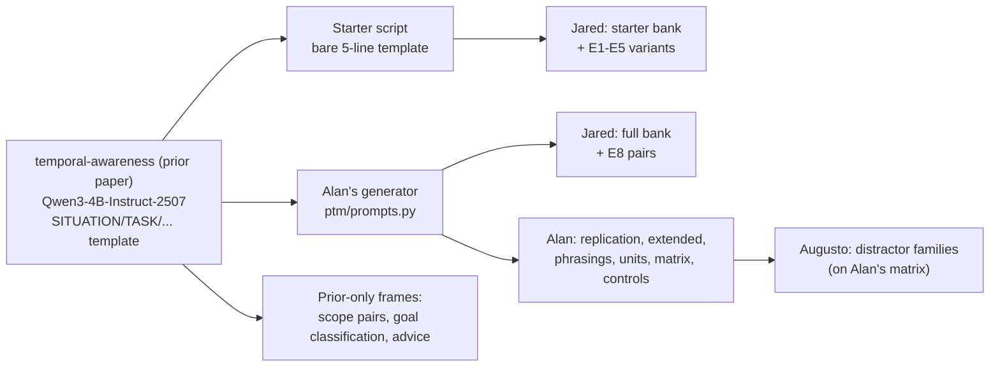
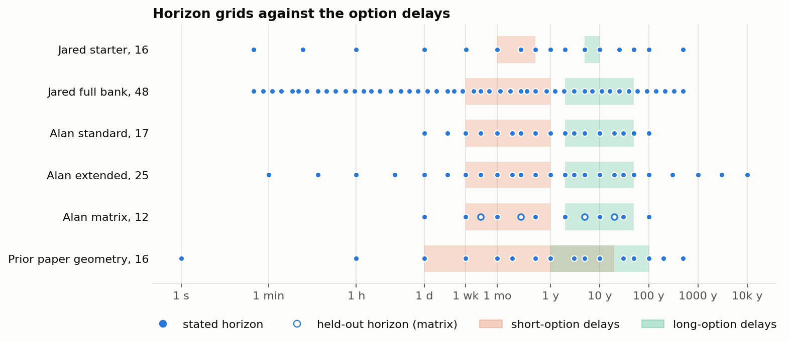
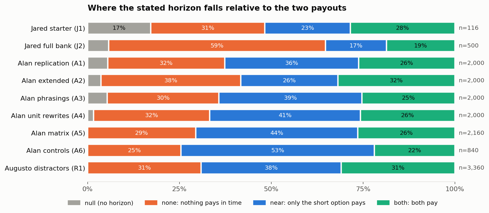
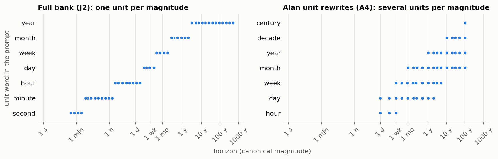
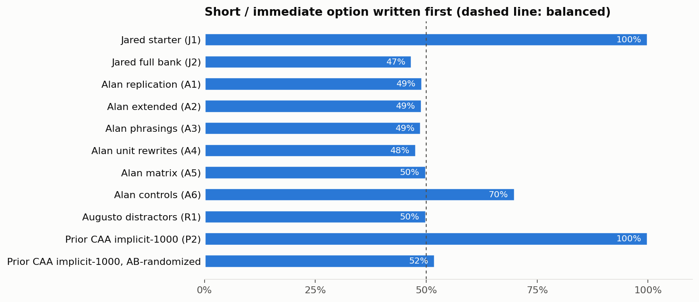
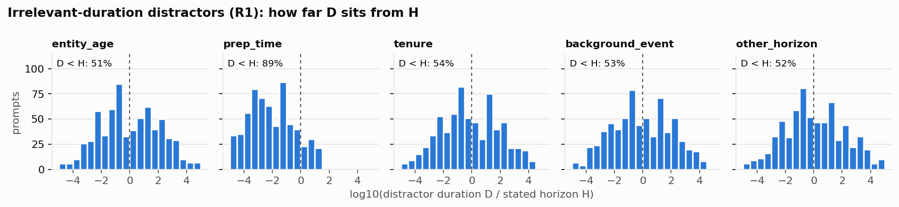

# Prompt types used to study the internal horizon representation

**Shared definitions for the team (Jared, Alan, Augusto).** Status: 2026-10-12.
Covers the prompts already in use. New types come later.

This document:
- gives every existing prompt a type,
- shows real examples,
- plots what the banks contain,
- lists the problems each type has for the question *"how does the model represent its time horizon internally?"*

Per-family source detail (file:line, counts, results) is in [`00_prompt_inventory.md`](00_prompt_inventory.md).

Every example below was generated from the code or data on disk. The one exception is P1, which is traced by hand. Figures come from `scripts/`; see §8 to regenerate them.

---

## 0. Terms

| Term | Meaning |
|---|---|
| **H** | The horizon stated (or implied) in the prompt, in years. |
| **Short / near option** | The smaller reward with the earlier delay. **Long / far option**: the larger reward with the later delay. |
| **Regime** | Where H falls relative to the two delays: `none` (H < short delay: nothing pays in time), `near` (only the short option pays), `both` (H ≥ long delay), `null` (no horizon). Definition: `jared/spar_horizon/full_bank.py:284`. |
| **Truth** | The rational choice, defined only in `near` (short) and `both` (long). |
| **Suffix / T0-T8** | The 9 chat-template tokens after the user text with thinking off: `<|im_end|>` `\n` `<|im_start|>` `assistant` `\n` `<think>` `\n\n` `</think>` `\n\n`. Alan and Augusto call them T0-T8. Jared calls them suffix positions 0-8. |
| **Readout cell** | One (layer, token position) where a probe or decoder is read. |

## 1. Lineage



Every type in the SPAR repo descends from one task: the prior paper's two-option intertemporal choice with the horizon written into a CONSTRAINT line.

## 2. The types at a glance

The type names are owner-agnostic. Use these names in docs and code. The instance IDs (J*, A*, R*, P*) match the inventory.

| Type | One-line definition | Instances | Prompts | Models run |
|---|---|---|---|---|
| **IC-BASE** | Two-option intertemporal choice; H stated as a duration in one canonical sentence | J1, J2, A1, A2, A5-structured, P1 | 96-4,590 per bank | 0.8B, 8B (J); 14B (A); 4B-I (P) |
| **IC-NULL** | IC-BASE with the horizon sentence removed or replaced by "greatest benefit" | J1 controls, null rows of J2/A1-A4, P1 `None` | 20-110 per bank | as IC-BASE |
| **IC-WORD** | IC-BASE with the horizon sentence or the whole prompt reworded; same H | J4 (6 wordings), A3 (4), A5 plain/varied | 576; 2000; 1440 | 8B; 14B |
| **IC-UNIT** | IC-BASE with H written in another unit of about the same magnitude | J5, A4 | 108; 2000 | 8B; 14B |
| **IC-LAYOUT** | IC-BASE with option order swapped, labels changed, or the horizon sentence moved | J3, J6 horizon_first, P1 label styles | 96 each | 8B; 4B-I |
| **IC-IMPLICIT** | The horizon sentence is replaced by a life event that implies H | J6 implicit | 60 | 8B |
| **IC-NOISE** | IC-BASE plus one irrelevant sentence with no duration | J6 distractor | 96 | 8B |
| **IC-DISTRACT** | IC-BASE plus one sentence holding an irrelevant duration D ≠ H | A6 mention/role, R1 (5 families) | 480; 3360 | 14B |
| **IC-SCALE** | H and both delays multiplied by the same factor (×0.1, ×1, ×10) | A6 scaling | 360 | 14B |
| **IC-PAIR** | Clean/corrupt pairs: same options, H moved across a regime boundary, same token length | J7 (E5), J8 (E8), P1 contrastive pairs | 48; ≤96; ~100 | 8B; 4B-I |
| **IC-MULTI** | H set in turn 1, measured in turn 2 | J9 (draft) | ~600 | **never run** |
| **FACT** | A statement of the options and a horizon, with no task and no answer | A6 factual | 240 | 14B |
| **SCOPE** | Short-term vs long-term approach as (A)/(B), with no numbers; explicit or implicit wording | P2 | 50-1000 per file | GPT-2, 4B-I, Llama-3.1-8B |
| **GOAL** | "Is this a short-term or long-term goal?" over goals with no time words | P3 | 200 pairs | Qwen3-4B(-I) |
| **ADVICE** | Open-ended advice prompts used only to evaluate steering | P4 | 7 | 4B-I |

**Option count.** Every horizon prompt we have used offers exactly two options. No type has three or more. The only 4-option multiple-choice sets in any of the repos belong to the prior project's separate patience-degradation study (`temporal-awareness/data/processed/patience_degradation/`). They are:
- TRAM ordering (1600)
- TRAM arithmetic (15,584)
- a filtered MedQA "temporal" set (128)

None was used to locate a horizon representation.

## 3. Anatomy of the base prompt

The IC types come in three layouts. The horizon sentence is in **bold** in each.

**Bare starter layout** (J1 and its E1-E5 variants):

```
You must choose the best investment:
a) 20,000 dollars in 6 months.
b) 500,000 dollars in 10 years.
**Select the option with the greatest benefit for this time horizon: 3 months.**
Answer with a) or b).
```

**Structured layout** (J2, A1-A4, A5-structured; P1 is close to it):

```
SITUATION: Plan for the future of the household.
TASK: You, the head of the household, are tasked to choose the best investment:
a) 625,000 dollars in 10 years.
b) 25,000 dollars in 1 week.
OBJECTIVE: Think deeply about which option is preferable.
**CONSTRAINT: You must select the option that provides the greatest benefit for this time horizon: 3 weeks.**
ACTION: Select one of the two options. Provide reasoning.
FORMAT: I choose: <a) or b)>. My reasoning: <1-3 sentences>
```

**Plain-prose layout** (A5-plain, A6, R1):

```
You are the administration of a city planning its climate policy. The city is deciding which emissions program to fund. Two options are available: a) 1,000 tonnes of CO2 prevented in 6 months, or b) 10,000 tonnes of CO2 prevented in 20 years. **Your time horizon for this decision is 2 years: choose the option that provides the greatest benefit within it.** Select one of the two options and give your reasoning. Respond in this format: I choose: <a) or b)>. My reasoning: <1-3 sentences>
```

**After the user text** (thinking off, Qwen3), with each group's main readout cell:

| Token | `<|im_end|>` | `\n` | `<|im_start|>` | `assistant` | `\n` | `<think>` `\n\n` `</think>` `\n\n` | `I` ` choose` `:` | ` a` |
|---|---|---|---|---|---|---|---|---|
| Name | T0 | **T1** | T2 | **T3** | T4 | T5-T8 | prefill or generated | label |
| Who reads here | | Jared probe (suffix newline, L11-16); Alan/Augusto decoder (L26, L18) | | Alan PC1 peak (L35-37) | sink direction hides H from PC1 | | Jared E8 pre-label `:` (L21-30) | answer logit |

The `I choose:` tokens differ by group:
- **Jared, starter bank since v2:** a prefill we append.
- **Jared full-bank E0, Alan, Augusto:** the model writes it itself.
- **Prior paper:** two forced trajectories, `"I choose: a)"` vs `"I choose: b)"`.

With thinking on, the suffix is 5 tokens and the model writes `<think>` itself. Jared force-closes the think block after 3072 tokens.

## 4. Type definitions with examples

Each type lists:
- what varies and what is fixed,
- examples,
- what it was used for,
- its problems (IDs refer to §6).

### IC-BASE: explicit-horizon choice

**Varies:**
- H, on a grid (Figure 1).
- Rewards and delays: fixed pairs in J1, sampled per prompt elsewhere.
- Option order: fixed in J1, random in J2 and A1, tied to config in A5.

**Fixed:** the task, the horizon sentence, the labels a)/b), and the domain (investment, plus climate in A5).

Examples: the starter and structured layouts in §3. A `none`-regime full-bank prompt (H = 4 days, while the earliest payout is in 1 year):

```
SITUATION: Plan for the future of the household.
TASK: You, the head of the household, are tasked to choose the best investment:
a) 25,000 dollars in 1 year.
b) 125,000 dollars in 5 years.
OBJECTIVE: Think deeply about which option is preferable.
CONSTRAINT: You must select the option that provides the greatest benefit for this time horizon: 4 days.
ACTION: Select one of the two options. Provide reasoning.
FORMAT: I choose: <a) or b)>. My reasoning: <1-3 sentences>
```

**Used for:** geometry and probes, i.e. PC1 vs log H and ridge or MLP probes.

**Results:**
- Probe R² is about 1.00 at T1 (8B, L11-16).
- Alan: PC1 |ρ| 0.96 at T3 (14B), on a planar curve (PC1 linear, PC2 quadratic).
- Jared, E7: the horizon lies on a 1-2 dimensional curve before reasoning and is diffuse during it.

**Problems:** Q1, Q2, Q3, Q4, Q5, Q6, Q7, Q13, Q14, Q15.

### IC-NULL: no-horizon control

**Varies:** as IC-BASE, with the horizon sentence dropped (structured layout) or replaced (starter layout).

Starter example:

```
You must choose the best investment:
a) 1,000 dollars in 1 month.
b) 50,000 dollars in 5 years.
Select the option with the greatest benefit.
Answer with a) or b).
```

**Used for:** the behavioral baseline. Without a horizon the 14B picks the long option about 90-96 % of the time.

**Problems:**
- 20-110 prompts per bank, too few to fit geometry on.
- The text is not matched to an IC-BASE prompt: the null prompt is shorter by a whole sentence. Alan flagged "content-matched prompts without a stated horizon" as an unfilled gap.
- Q1 applies in reverse: absence of the sentence is trivially detectable.

### IC-WORD: wording variant

**Varies:** the horizon sentence (J4, A3) or the whole prompt rendering (A5 plain, varied).

**Fixed:** H, the options and their order.

J4 `deadline`:

```
You must choose the best investment:
a) 20,000 dollars in 6 months.
b) 500,000 dollars in 10 years.
Your deadline is 3 months. Select the option with the greatest benefit by then.
Answer with a) or b).
```

A3 phrasing 2. This is a strict cutoff, unlike the others:

```
CONSTRAINT: Only outcomes within the next 1 week matter for this decision.
```

A5 varied: the same facts as the plain-prose example in §3, but with the horizon sentence moved before the options:

```
You are the administration of a city planning its climate policy. The city is deciding which emissions program to fund. Your time horizon for this decision is 2 years: choose the option that provides the greatest benefit within it. Two options are available: a) 1,000 tonnes of CO2 prevented in 6 months, or b) 10,000 tonnes of CO2 prevented in 20 years. Select one of the two options and give your reasoning. Respond in this format: I choose: <a) or b)>. My reasoning: <1-3 sentences>
```

**Used for:** testing whether the horizon representation survives rewording.

**Results:**
- J4, 8B: transfer 0.99 at L10, within one layout.
- A3, 14B: within a phrasing, 0.86-0.97. Pooled PCA clusters by phrasing (silhouette 0.77 at L14), and the clusters merge by L29.
- A5: a decoder trained on the structured layout scores 0.34-0.39 on prose.

**Problems:** Q1, Q8, Q9.

### IC-UNIT: unit variant

**Varies:** the unit H is written in. Values stay within 10 % of the canonical magnitude.

**Fixed:** everything else. A4 pairs share the options and order exactly. J5 example, "1 week" written as hours:

```
Select the option with the greatest benefit for this time horizon: 168 hours.
```

One A4 pair renders the same base prompt as `1 year`, `12 months`, `52 weeks` and `365 days`.

**Used for:** separating magnitude from the unit word (Figure 3).

**Results:**
- J5: within-duration / between-duration spread 0.13.
- A4: rewrites move the decoder by less than one grid step, yet behavior shifts with "decades" (Δp_short −0.11) and "centuries" (−0.07).

**Problems:** Q2, Q13.
- J5 has only 6 durations.
- A4 was never run with thinking on or on the 8B.

### IC-LAYOUT: order, label and position nuisance

**Varies:** option order (swap), labels (`1)`/`2)`, or 9 label styles in P1), and where the horizon sentence sits (horizon_first).

Swap and horizon_first:

```
You must choose the best investment:
a) 500,000 dollars in 10 years.
b) 20,000 dollars in 6 months.
Select the option with the greatest benefit for this time horizon: 3 months.
Answer with a) or b).
```

```
You must choose the best investment:
Select the option with the greatest benefit for this time horizon: 3 months.
a) 20,000 dollars in 6 months.
b) 500,000 dollars in 10 years.
Answer with a) or b).
```

**Used for:** nuisance invariance and behavioral stability.

**Results:**
- Probe transfer: swap 0.99, relabel 1.00, horizon_first 0.90.
- Behavior moves: order stability is 41 % with thinking off and 74 % with it on (starter, 8B).

**Problems:** Q4, Q6.

### IC-IMPLICIT: event-cue horizon

**Varies:** the horizon sentence is replaced by a life event. There are 10 events, one per H from 1 week to 50 years.

```
You must choose the best investment:
a) 20,000 dollars in 6 months.
b) 500,000 dollars in 10 years.
My daughter starts college in five years and I need the money for it.
Answer with a) or b).
```

**Used for:** whether the explicit-H probe reads an implied horizon. Transfer was 0.88.

**Problems:**
- Q10: the duration is still stated ("in five years") and every sentence adds a need-the-money motive.
- 60 prompts.
- Q1 is only partly avoided.

### IC-NOISE: irrelevant non-temporal sentence

The fixed sentence is inserted after the options:

```
...
b) 500,000 dollars in 10 years.
The weather has been unusually mild this season, and the local market opens at nine.
Select the option with the greatest benefit for this time horizon: 3 months.
...
```

**Result:** transfer 0.996, i.e. no effect.

**Problems:**
- One fixed sentence only.
- It contains a time-like phrase ("opens at nine") that is never varied.

### IC-DISTRACT: irrelevant duration

**Varies:**
- the family of the distractor sentence (Alan: mention, role; Augusto: entity_age, prep_time, tenure, background_event, other_horizon),
- its template (2 seen + 2 unseen per family),
- its slot (after the role, before the options, after the horizon),
- D.

Every R1 prompt has a clean twin that differs only by the inserted sentence.

Augusto `other_horizon`, unseen template, H = 1 day, D = 30 years:

```
You are the head of a household planning its finances. The previous plan, which has now ended, covered a period of 30 years. The household is deciding how to invest. Two options are available: a) 100,000 dollars in 20 years, or b) 10,000 dollars in 1 year. Your time horizon for this decision is 1 day: choose the option that provides the greatest benefit within it. Select one of the two options and give your reasoning. Respond in this format: I choose: <a) or b)>. My reasoning: <1-3 sentences>
```

Alan `role`, H = 1 month, D = 1 hour:

```
... Your time horizon for this decision is 1 month: choose the option that provides the greatest benefit within it. You have 1 hour to prepare your recommendation. Select one of the two options ...
```

**Used for:** separating "the operative horizon" from "any duration in context".

**Results:**
- The model's choices ignore D in all five families.
- A decoder trained on clean prompts is pulled toward D: Alan's residual correlation is +0.58 / +0.74; Augusto's paired pull is 0.07-0.33.
- Training the decoder with distractors removes the pull on seen families. On held-out families the removal is only partial.

**Problems:** Q1 (the horizon-sentence regex scores 0.94), Q11, Q12, Q13.

### IC-SCALE: option and horizon scaling

H and both delays are multiplied by 0.1, 1 or 10, so their ratios are kept. Example at ×0.1 (base: 1 month, 6 months, 20 years):

```
... Two options are available: a) 1,000 dollars in 18 days, or b) 10,000 dollars in 2 years. Your time horizon for this decision is 3 days: ...
```

**Used for:** whether the readout is absolute or relative to the options. The slope was 0.61-0.81, so the readout is mostly absolute.

**Problems:**
- Q2: scaling changes the unit word too (days ↔ months ↔ years).
- Only 6 base horizons.

### IC-PAIR: matched clean/corrupt pairs

**What is matched:** the options are identical and the horizon phrase has the same token length. H crosses from the `near` regime (only the short option pays) to `both`.

**J7 pairs** use the starter layout, e.g. "16 months" vs "25 years" and "23 months" vs "16 years".

**J8 pairs** use the full bank in two modes:
- crossing pairs: the donor's H comes from the other regime;
- answer-slot pairs: the recipient and donor have the near option under the same label.

**P1** pairs prompts the model answered short-term with prompts it answered long-term, at ≥ 0.8 confidence.

**Used for:** activation and attribution patching, ablation and steering.

**Results:**
- E5 (v1): 33/48 flips, with attribution on the " months" token at L13-15 and on the final positions.
- E8: H reaches the `:` before the label only from L24. The probe-chosen cells are passengers: 12/12 pre-registered verdicts failed.
- Prior paper: decision circuit at L21-35, with L24 attention the top component.

**Problems:**
- Q2: "months" vs "years" differ within a J7 pair.
- Q4: in J1 the near option is always `a`.
- Q6: the bold-marker lead token dominated v3 attribution.

### IC-MULTI: carried horizon (drafted, not run)

Turn 1 is a choice whose answer we prefill. Turn 2 is the starter prompt and is where we measure.

**Conditions:**
- single
- unrelated (turn 1 is "Which is heavier? a) 2 kilograms of iron b) 1 kilogram of feathers…")
- same H
- conflicting H (offset by ±2/4/8 grid steps)
- carry_silent (turn 2 has no horizon)
- carry_ref (turn 2 says "Same time horizon as before.")

**Status:** never run. It is listed so that the type name is reserved.

### FACT: horizon statement with no task

```
The household holds two investments: one pays out 1,000 dollars after 6 months, the other pays out 10,000 dollars after 20 years. Its planning horizon is 1 month.
```

**Used for:** whether a decoder trained on the task reads H without one. The result was weak: RMSE 1.27-3.40 decades.

**Problems:**
- The short option is always listed first.
- There is no behavior to compare against.

### SCOPE: temporal-scope preference pairs (prior project)

Explicit and implicit examples:

```
The timeline we should optimize for is:
(A) The next few hours and days
(B) The coming decades and beyond
```

```
A restaurant's approach to repeat diners emphasizes
(A) remembering preferences and personalizing each visit
(B) serving each table and turning it over efficiently
```

The implicit example is from the AB-randomized copy. Its long-term option is (A).

**Used for:** probes, CAA vectors, EAP-IG and binary-choice steering.

**Results:**
- 4B-I probe: 0.992 on implicit, 0.88 transfer to explicit.
- Steering at L19-22 raised long-term choices from 68.6 % to 97.2 %.

**Problems:**
- The original files put the immediate option at (A) in 100 % of pairs (Figure 4).
- There is no numeric H, so the result is a binary short/long direction, not a magnitude.

### GOAL: goal-horizon classification (prior project)

The clean and corrupted prompts of one pair:

```
The goal is to cook a warm dinner for the family. Is this a short-term or long-term goal? The answer is:
The goal is to become a top chef in the city. Is this a short-term or long-term goal? The answer is:
```

**Used for:** activation patching. The computation sits in L29-31 of Qwen3-4B.

**Problems:**
- Ambition and scale confounds, as noted in the dataset README.
- Binary, with no magnitude.

### ADVICE: open-ended steering evaluation (prior project)

Seven prompts, for example: "A nonprofit is deciding whether to expand now or build reserves. What would you suggest?"

**Problems:** the outputs were scored by hand (702 responses) and no H is defined.

## 5. Figures

### Figure 1. Horizon grids against the option delays



Each row is one bank's set of stated horizons. The shaded bands are the delay ranges of the short option (orange) and the long option (aqua).
- Any horizon left of the orange band is in the `none` regime: no option pays in time.
- Below 1 week, the full bank's 48-point grid is all `none`. That is 24 of its 48 points.
- In the prior paper's geometry config the two bands overlap (short delays reach 20 years, long delays start at 1 year), so many of its prompts are not a short-vs-long tradeoff (Q14).

### Figure 2. Regime composition per dataset



| Dataset | n | null | none | near | both |
|---|---|---|---|---|---|
| Jared starter (J1) | 116 | 20 | 36 | 27 | 33 |
| Jared full bank (J2) | 500 | 29 | **295** | 83 | 93 |
| Alan replication (A1) | 2000 | 110 | 637 | 729 | 524 |
| Alan extended (A2) | 2000 | 73 | 762 | 528 | 637 |
| Alan phrasings (A3) | 2000 | 108 | 608 | 779 | 505 |
| Alan unit rewrites (A4) | 2000 | 33 | 632 | 821 | 514 |
| Alan matrix (A5) | 2160 | 0 | 636 | 954 | 570 |
| Alan controls (A6, no factual) | 840 | 0 | 214 | 442 | 184 |
| Augusto distractors (R1) | 3360 | 0 | 1040 | 1280 | 1040 |

Only `near` and `both` have a defined right answer. That is 35 % of the full bank, against 58-71 % of Alan's banks (A1-A5).

### Figure 3. The unit word tracks the magnitude



- **Left:** in the full bank each unit word covers one band of magnitudes, so "which unit" is almost "which horizon". The unit explains 0.97 of log H, and at the answer slot the horizon direction is a staircase by unit (Q2).
- **Right:** Alan's paired rewrites write one magnitude in up to four units. This is the only set that breaks the link, and it has been run on the 14B only.

### Figure 4. Option order



Share of prompts with the short (or immediate) option written first, i.e. labelled `a` or `(A)`:

| Dataset | Short option first |
|---|---|
| Jared starter (J1) | 100 % |
| Jared full bank (J2) | 47 % |
| Alan A1-A4 | 48-49 % |
| Alan matrix (A5) | 50 % overall, **but constant within each option config** |
| Alan controls (A6) | 70 % |
| Augusto distractors (R1) | 50 % (inherits A5's per-config order) |
| Prior SCOPE implicit-1000, original | 100 % |
| Prior SCOPE implicit-1000, AB-randomized | 52 % |

### Figure 5. How far the distractor duration sits from H



The x-axis is log10(D / H) for each of Augusto's five families. Four families are symmetric around 0. In `prep_time`, D is shorter than H in 89 % of prompts, because D only runs from 1 hour to 1 month. Its pull therefore shows up as a constant shift (−0.53 decades) that a slope metric underestimates (Q12).

## 6. Problem register

Severity is for claims about the internal horizon representation:
- **High:** can produce a wrong conclusion about the representation.
- **Medium:** biases a number.
- **Low:** cosmetic or local.

| ID | Problem | Types affected | Evidence | Severity |
|---|---|---|---|---|
| Q1 | **The horizon is written in the prompt**, so it is decodable by construction. A high probe R² shows the duration was read, not that the model uses a horizon variable. | All IC types, FACT | Text regex scores 1.00 on Alan's explicit suites and 0.94 on R1. E8: ablation removes ≤ 0.06; 12/12 verdicts failed. | High |
| Q2 | **The unit word tracks magnitude.** Probes and patching can latch onto "months" vs "years" instead of a magnitude. | IC-BASE (J2), IC-PAIR (J7), IC-SCALE | Unit explains 0.97 of log H (J2). Answer-slot direction is a staircase by unit. E5 attribution on " months". A4: decades and centuries shift behavior. | High |
| Q3 | **Many prompts are ill-posed.** In the `none` regime nothing pays in time, so the question has no answer; behavior there is near chance. | IC-BASE and every type derived from it | Full bank 59 % `none`. Alan 29-38 %. Below the shortest delay, the 14B picks short 51-73 % of the time (A2). | High |
| Q4 | **Option order is confounded with position or config.** Position bias, label bias and the rational answer can line up. | J1 (always `a`), A5 and R1 (order fixed per config), A6 (70 %), SCOPE originals (100 %) | Figure 4. On J1, 8B order stability is 41 % with thinking off. | High for J1 behavior; medium elsewhere |
| Q5 | **Fixed delays in the starter bank** make the right answer a step function of H. A label probe is then a horizon probe. | J1 and its variants | 2 delay pairs, 3 reward pairs | Medium |
| Q6 | **Readout fragility.** The label position moves, or a format token dominates. | All behavior readouts | Without the prefill the 8B writes prose 85 % of the time. Bold `**a)` in about 5 % (A1). Unspaced label in 351/5520 (R1), mismatched in 108 twin pairs. The `' **'` lead token dominates E5 v3 attribution at L30-35. | Medium |
| Q7 | **Forced think closes.** Forced and natural closes are linearly separable, so thinking-on cells mix "ran out of budget" with "horizon". | IC-BASE thinking-on (J1 v3, J2) | 46-48/116 (starter) and 103/500 (full) forced. AUC 1.00 at the think close. bf16 batched decoding gives 46 vs 48 across reruns. | High for thinking-on claims |
| Q8 | **Layout and wording dominate pooled geometry.** PC1 tracks the template before H. | IC-WORD, any pooled analysis | A5 pooled PC1 \|ρ\| with H is 0.05-0.12. A3 silhouette 0.77 at L14. Structured → prose decoder transfer 0.34-0.39. | Medium |
| Q9 | **Paraphrases are not synonyms.** "Only outcomes within the next H" is a strict cutoff. "You need the money within H" adds a motive. | IC-WORD | Short-choice rate by phrasing: 0.61-0.78 (A3) | Medium |
| Q10 | **The implicit cue is not implicit.** Every event sentence states the duration and adds a need-the-money motive. | IC-IMPLICIT | 10/10 sentences contain "next week", "in five years", etc. 60 prompts. | Medium |
| Q11 | **Decoders follow any duration; behavior does not.** The probed direction is "durations in context", partly, rather than "my horizon". | IC-DISTRACT, and any decoder trained on clean prompts | Pull +0.58/+0.74 (A6), 0.07-0.33 (R1). Behavior pull ≈ 0 in all families. | High |
| Q12 | **Distractor D ranges differ by family.** Gap ranges differ, and prep_time uses hours, a unit H never has. | IC-DISTRACT (R1) | Figure 5. D sets have 7, 11 or 12 values. Constant shift of −0.53 decades. | Low |
| Q13 | **Rendering artifacts.** Ungrammatical or odd text the model may treat differently. | J1 family; P1; R1 | "1 years", "1 days", "3600 seconds" (J1/J4/J6/J7). P1: horizon padded with spaces, "1 millenium", "You, , are tasked". R1: "A separate long-term project … runs for 1 day". | Low |
| Q14 | **The prior paper's geometry options are not a tradeoff.** Both options draw rewards from 1k-100k, and their delay ranges overlap. | P1 (GEOMETRY_CFG) | Figure 1, bottom row | Medium when comparing to the prior paper |
| Q15 | **"Think deeply" with thinking off.** The OBJECTIVE line asks for reasoning the mode forbids. | Structured layout (J2, A1-A5) | Template text | Low |
| Q16 | **Results are not comparable across groups.** Different models, layouts and readouts. | All | Jared: 8B, bare/structured, prefill or located label. Alan/Augusto: 14B, structured/prose, located label. Prior: 4B-I, forced trajectories. | Medium |
| Q17 | **One task.** Every SPAR prompt is a single-turn, two-option choice with an instructed H. The measured representation is of an instructed constraint inside one decision format. | All IC types | No planning, multi-step, multi-option or multi-turn prompt has been run (IC-MULTI is a draft) | High for claims about a general horizon representation |

## 7. Coverage

✓ = run. — = not run.

| Type | Jared 8B off | Jared 8B on | Alan 14B off | Augusto 14B off | Prior 4B-I |
|---|---|---|---|---|---|
| IC-BASE | ✓ starter, full | ✓ starter, full | ✓ | ✓ (clean matrix) | ✓ |
| IC-NULL | ✓ | ✓ | ✓ | — | ✓ |
| IC-WORD | ✓ (starter) | — | ✓ | ✓ (plain/varied) | context variants only |
| IC-UNIT | ✓ (starter, 6 durations) | — | ✓ | — | — |
| IC-LAYOUT | ✓ | behavior only | — | — | label styles |
| IC-IMPLICIT | ✓ (60) | — | — | — | — |
| IC-NOISE | ✓ | — | — | — | — |
| IC-DISTRACT | — | — | ✓ | ✓ | — |
| IC-SCALE | — | — | ✓ | — | — |
| IC-PAIR | ✓ (E5, E8) | ✓ (E8) | — | — | ✓ |
| IC-MULTI | — | — | — | — | — |
| FACT | — | — | ✓ | — | — |
| SCOPE / GOAL / ADVICE | — | — | — | — | ✓ |

## 8. Regenerating the figures

```fish
cd ~/SPAR/spar-planning-temporal-manifolds
# 1. Derived numbers. Needs pandas + pyarrow (not in any conda env), so uv supplies them.
uv run --no-project --with pandas --with pyarrow python PromptDefinitions/scripts/extract_prompt_stats.py
# 2. Figures, on the intel_ai env.
~/miniconda3/envs/intel_ai/bin/python PromptDefinitions/scripts/make_figures.py
```

`figures/prompt_stats.json` holds every number plotted above:
- the regime counts,
- the order balance,
- the grids,
- the unit pairs,
- the distractor gaps.
