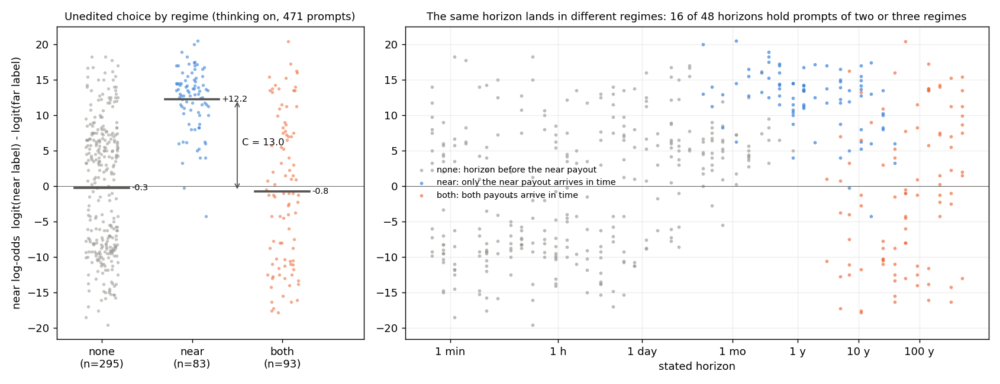
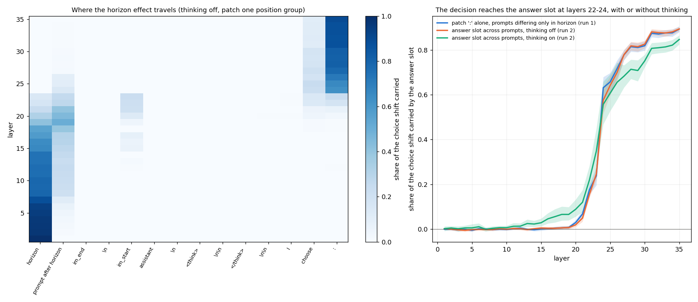
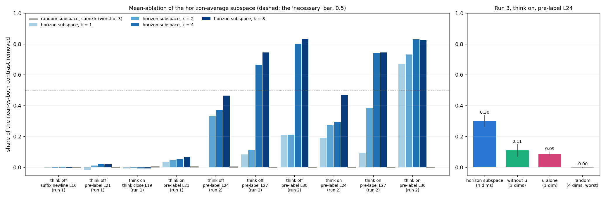
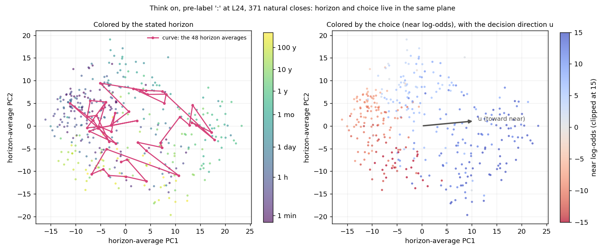
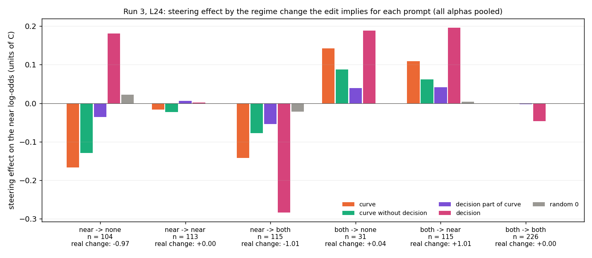
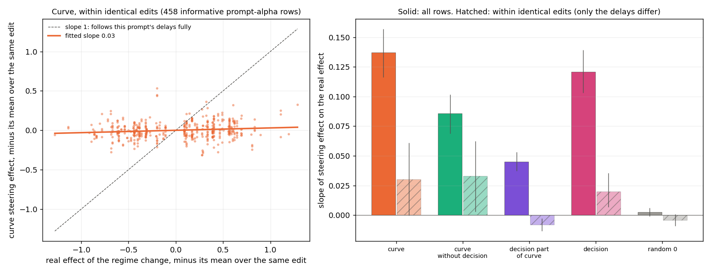

# The causal tests explained: baselines, patching, ablation, horizon vs decision

Date: 2026-10-14. Qwen3-8B, full bank. This document explains the methods
behind the E8 numbers in `08_results_steering.md` (specs in `07_spec_steering.md`
§3-5, §9, §10): what each test does, which prompts it uses, what it is compared
against, and how we try to tell a horizon representation from a decision
representation. It adds no new box runs; the figures and every number below come
from saved results:

```
python analysis/causal_walkthrough.py results/horizon
-> figures/causal_*.png, results/horizon/analysis/causal_walkthrough.{json,txt}
```

## 1. The task and the outcome we measure

Every prompt asks the model to choose between a small payout soon and a large
payout later, "for this time horizon: X". An example from the bank (the first
patching pair's recipient):

```
SITUATION: Plan for the future of the household.
TASK: You, the head of the household, are tasked to choose the best investment:
a) 25,000 dollars in 3 months.
b) 50,000 dollars in 20 years.
OBJECTIVE: Think deeply about which option is preferable.
CONSTRAINT: You must select the option that provides the greatest benefit for this time horizon: 91 years.
ACTION: Select one of the two options. Provide reasoning.
FORMAT: I choose: <a) or b)>. My reasoning: <1-3 sentences>
```

Delays, rewards, option order and wording are drawn per prompt. The **regime**
is where the horizon falls relative to the two delays:

| regime | horizon is | rational answer | prompts (of 471 with a horizon) |
|---|---|---|---|
| `none` | shorter than the near delay | undefined, nothing pays in time | 295 |
| `near` | between the two delays | the near option | 83 |
| `both` | past the far delay | the far option (larger) | 93 |

The example is `both` (91 years is past 20 years).

**Outcome.** The near log-odds, `logit(near label) - logit(far label)`, at the
token right before the label (the `:` of the model's own `I choose:`). It is read
in one forward pass, with no sampling. With thinking on, the model's own
reasoning, cached from the E0 run, is fed back unchanged up to that token.

**Prompts in every causal test:** the 176 `near` and `both` prompts, the
only ones where the horizon decides the rational answer.

**Unit of effect.** `C = mean LO(near) - mean LO(both)` on the unedited prompts.
This is how much the model's preference changes between "only the near option
pays" and "both pay" (12.9 log-odds with thinking on, 11.4 off). Every effect is
`mean(LO_edited - LO_unedited) / C`. An effect of 1 is as large as a real
regime change; 0.1 is a tenth of one.

## 2. Baselines

### 2.1 Unedited behavior



**Left:** with thinking on, the model separates the regimes cleanly:
- `near` prompts average +12.2 near log-odds.
- `both` prompts average -0.8.
- `none` prompts average -0.3.

The `none` mean is not indifference: those prompts split into confident near
and confident far choices. In mean terms the model answers them like `both`
prompts. That matters below, because shortening a `near` prompt's horizon
into `none` should lower its near log-odds.

**Right:** regimes are not a function of the horizon alone. 16 of the 48
horizons contain prompts from two or three regimes, because the delays vary
per prompt. The horizon-vs-decision test in §6.4 depends on this.

### 2.2 The controls

Every causal number in E8 is read against one or more of these:

| baseline | what it controls for | where | value |
|---|---|---|---|
| unedited near log-odds per prompt | the zero point of every effect | all tests | per prompt, saved |
| contrast C | the size of a real regime change | all tests | 12.9 on, 11.4 off |
| random subspace, same k, same mean | ablation simply disrupting the residual stream | ablation | 0.00 at every cell |
| random direction, same length as the curve step | steering simply pushing activations off distribution | steering | at most 0.03 toward rational, 2 decades |
| probe line (ridge direction for log horizon) at the curve's length | whether the curve's shape matters, or any horizon direction works | steering | at most 0.01 at every cell, 2 decades |
| mean difference (long half minus short half, the prior paper's CAA) | the method of the prior paper | steering | small; backwards at think-on L24 (§6.5) |
| unit word alone (mean log horizon of training horizons with the same unit) | decoding the unit word instead of the duration | probes (`06` §5) | R² 0.96 |
| decision alone, used to predict the horizon | horizon decodability that comes only through the choice | decision check (§6.1) | R² 0.00-0.06 |
| pure push along the decision direction `u` | the within-edit test's result if only a decision is moved | §6.4 | 0.02 |
| donor-recipient gap below 1 log-odds | patching pairs with nothing to transfer | patching | 4 of 96 pairs dropped (T1) |

## 3. Activation patching: which prompts, what is swapped

Patching moves the hidden state of a **donor** prompt into a **recipient** prompt
at one layer and one set of positions, and measures how much of the
donor's choice comes with it:

```
transfer = (LO_patched - LO_recipient) / (LO_donor - LO_recipient)
```

Transfer 1 means the patched positions carry the whole difference between the
two prompts at that layer; 0 means they carry none. "Layer L" is the
`hidden_states` index: we overwrite the output of decoder block L-1.

### 3.1 T1: interchange patching inside one prompt (thinking off)

**Prompts.** For each `near`/`both` prompt, in bank order, the recipient is the
prompt itself. The donor is the identical prompt with the horizon replaced by
one from the other regime, drawn with a fixed seed among the 48 horizons. The
replacement must tokenize to the same length, so positions line up. 96 pairs:
46 recipients `near`, 50 `both`. Horizon shifts have a median of 1.3 decades
(range -3.3 to +3.5). 92 pairs differ by more than 1 log-odds (mean gap 11.6)
and are used. Examples (recipient -> donor; only the differing tokens are patched as "horizon"):

| recipient regime | recipient horizon | donor horizon | tokens patched as "horizon" |
|---|---|---|---|
| both | 91 years | 16 years | `91` -> `16` |
| both | 59 years | 10 days | `59 years` -> `10 days` |
| both | 5 years | 4 months | `5 years` -> `4 months` |
| near | 11 years | 91 years | `1` -> `9` |

Thinking off is teacher-forced through the template, which has an empty think
block: `...<|im_end|>\n<|im_start|>assistant\n<think>\n\n</think>\n\nI choose:`.

**Position groups**, patched one at a time at each layer 1-35:
- `horizon`: the 1-3 tokens that differ.
- `prompt after horizon`: every user-message token after them. This includes
  any shared unit word, e.g. ` years` in the first row.
- Each template token on its own, ending with the pre-label `:`.

Positions before the horizon are identical in the pair and are skipped.

**Why thinking off only:** with thinking on, patching a prompt position
changes the reasoning that follows, and the cached reasoning would no longer
match.

### 3.2 T5: answer-slot patching across prompts (both modes)

**Prompts.** The recipient is a `near`/`both` prompt. The donor is a
*different* prompt from the other regime whose near option has the same label
(a or b), so "prefer a)" means the near option in both. Delays, rewards, wording
and horizon all differ; only 1 pair of 64 shares a horizon.
- Thinking off: 96 pairs, 89 used.
- Thinking on: 64 pairs, 60 used (mean gap 14.2).

**What is swapped:** only the last position, the `:` before the label, at
one layer. Each prompt keeps its own reasoning. Across different reasoning
traces, the last position is the only one that lines up.

### 3.3 Result



**Left (T1):**
- The horizon's effect stays on its own tokens through about L14.
- It then spreads into the rest of the prompt (peak 0.50 at L19) and passes
  briefly through `<|im_start|>` (about 0.2 at L20-23).
- From L24 it sits on the answer slot `:` (0.63 at L24, up to 0.89).
- The suffix newline, where the horizon decodes at R² 1.00, carries 0.00 at
  every layer.

The groups add up to 0.92-1.00 at every layer, so nothing is missing from the map.

**Right (T5):** the decision arrives at the answer slot between L22 and L24,
with or without reasoning:
- Thinking on: 0.22 at L22, 0.56 at L24, 0.82 at L34.
- Thinking off reproduces T1's `:` column.

This is why the later ablation and steering focus on the answer slot at L24-30.

## 4. Ablation: what is removed, and which mean

**What is ablated.** At one cell (mode, position, layer), we fit the
**horizon subspace** on the saved E0 activations:
1. Take the 471 horizon prompts and center their activations.
2. Average them within each of the 48 horizons.
3. Run a PCA over those 48 averages.
4. Keep the top-k components as an orthonormal basis `B` [k, d], k in {1, 2, 4, 8}.

**Mean-ablation.** For every edited prompt, at that position and layer:

```
x  <-  x - ((x - mu) B^T) B
```

The component of `x` inside the subspace is replaced by the component of `mu`;
everything orthogonal to the subspace is untouched. Every prompt then looks,
inside the subspace, like the average prompt.

**Which mean `mu`:** the average activation at the *same cell* (same mode,
position and layer) over the prompts the subspace was fitted on.
- Runs 1 and 2: all 471 horizon prompts of that mode's E0 run, every regime
  (295 of them `none`), forced closes included.
- Run 3: the 371 prompts whose think block closed on its own.

It is not the mean of the 176 edited prompts, and it is not zero. Zero-ablation
would move the activation far off its distribution: at think-on pre-label L24
the mean has norm 183 (one outlier coordinate at 91), while prompts sit a median
21 from it. Mean-ablation removes the
*variation* inside the subspace and keeps the activation where real prompts sit.

**Where it is applied:**
- One position at one layer, for all 176 near/both prompts.
- At the pre-label cell this is the last position, so only the readout is edited.
- At the think-close cell (`</think>`, L19), later tokens attend to the edited
  state, but the reasoning text is fixed (cached).

**Metric:** the share of the contrast removed, `1 - C_edited / C_unedited`. The
95% interval comes from resampling prompts within each regime (1,000 resamples).

**Controls:**
- 3 random orthonormal k-dimensional subspaces, ablated toward the same `mu`.
- Run 3 adds two splits of the 4-dim subspace: the part orthogonal to the
  decision direction `u` (3 dims), and `u` alone (§6.2).



What the bars say:
- **Run 1 cells** (chosen where the horizon decodes best): nothing. At most 0.06 removed.
- **Answer slot, run 2:**
  - Thinking-on L24 removes 0.30 at k = 4.
  - L27 and L30 remove 0.74-0.83.
  - Random subspaces remove 0.00 everywhere.
- **The L27/L30 numbers are not evidence for the horizon.** At those layers the
  subspace also decodes the a-vs-b choice at R² 0.95 (§6.1), so ablating it
  removes the decision by construction. A large removed share means "something
  in this subspace is used", not "the horizon is used". §6 is about telling
  those apart.
- **Run 3 (right):** at L24 the subspace without `u` still removes 0.11
  [0.07, 0.15], and `u` alone removes 0.09.

## 5. Steering, briefly (needed for §6)

Steering adds a vector at the cell. The step size is `alpha` in {-2, -1, +1, +2}
decades of horizon (positive means longer). The directions:
- **Curve:** the 48 horizon averages, expressed in the top-8 PCs, define a
  piecewise-linear curve in log horizon. A prompt at horizon h moves by
  `curve(h + alpha) - curve(h)`.
- **Probe line:** the ridge direction for log horizon.
- **Mean difference:** the average over long horizons minus the average over short.
- **Random:** a random vector.
- **Decision `u`, and the two parts of the curve:** see §6.2.

Every direction moves each prompt as far as the curve does, so they differ in
direction only.

**"Toward the rational answer"** counts:
- `near` prompts at alpha > 0: a longer horizon should push them toward far.
- `both` prompts at alpha < 0: a shorter horizon should push them toward near.

It is signed so that positive means toward the answer the new horizon makes
rational.

## 6. Horizon or decision: the method

### The problem

After reasoning, at the answer slot, the model has already decided. The
horizon averages that define the subspace and the curve also differ in their
average *decision*: short horizons are all `none` (answered like `both`),
months to decades hold the `near` prompts, and the longest are `both`.

So a direction fitted from horizon averages can be a decision direction, and
moving along it can change the choice without any horizon content being used.
Figure 4 shows this at think-on L24: the same plane orders prompts by horizon
(left) and splits them by choice along PC1 (right).



The curve of averages (left, pink) is jagged at L24: each horizon has about
8 natural-close prompts of mixed regimes, so the averages are noisy. A curve
step of 2 decades is partly a jump between noisy averages.

### The handle that makes the question testable

A horizon representation that the model **compares with the delays** predicts
that an edit changes the choice only when the new horizon crosses one of
*this prompt's* delays:
- A `near` prompt edited to a horizon past its far delay should move toward far.
- A `near` prompt that stays between its delays should not move.

A **decision summary** ("prompts at this horizon usually chose near") predicts
that all prompts given the same edit move alike, whatever their delays. Because
one horizon holds prompts of several regimes (§2.1), these two predictions can
be separated. We use four checks, from weakest to strongest.

### 6.1 Decodability checks (local, saved activations; `08` §6)

On the top-4 horizon-subspace coordinates, 5-fold cross-validated ridge R²:

| cell | horizon from subspace | horizon from the decision alone | subspace adds beyond the decision | a-vs-b choice from subspace | near log-odds from subspace |
|---|---|---|---|---|---|
| on L24 | 0.77 | 0.06 | +0.72 | 0.23 | 0.65 |
| on L27 | 0.72 | 0.06 | +0.67 | 0.95 | |
| on L30 | 0.69 | 0.06 | +0.64 | 0.95 | |

- **What it shows:** the subspace holds horizon information the decision
  cannot explain, and at L27/30 it also holds the choice almost perfectly.
- **What it cannot show:** which of the two contents the model *uses*.
- At L24, the near-vs-far preference decodes at 0.65 even though the a-vs-b
  label decodes at only 0.23. L24 looks like the point where a preference
  exists before it is bound to a label (`08` §7).

### 6.2 Split the subspace along a decision direction (run 3, pre-registered in `07` §10)

**Decision direction `u`:**
- A ridge regression from the 8 subspace coordinates to each prompt's saved
  near log-odds (371 natural closes), mapped back to the residual stream and
  normalized.
- It lies inside the subspace, so the curve splits exactly into
  `curve = (curve along u) + (curve without u)`.
- Cross-validated R² of the near log-odds from the subspace: 0.86.

**Edits:**
- Steering by the curve, the curve without `u`, its `u` part, and `u` itself
  (at the curve's length, signed so that a longer horizon lowers the near log-odds).
- Ablation of the 4-dim subspace, the subspace without `u`, and `u` alone.

**Criteria, fixed before the run:**
- The curve without `u` moves the choice by at least 0.05 toward the rational
  answer (interval excluding 0) and by at least a third of the full curve's effect.
- Ablating the subspace without `u` removes at least 0.1 of C (interval excluding
  0), with every random subspace at most 0.05.

| | ablation, removed (k = 4) | steering toward rational, \|alpha\| = 2 |
|---|---|---|
| full subspace / curve | 0.30 [0.26, 0.34] | 0.13 |
| without `u` | **0.11** [0.07, 0.15] | **0.07** [0.05, 0.09] |
| `u` alone / `u` part of the curve | 0.09 [0.08, 0.10] | 0.05 |
| random | 0.00 | 0.01 |

**Both criteria pass.** The limit of this check: `u` is one direction of the
decision, not all of it. With `u` projected out, the remaining 7 dimensions
still predict the near log-odds at R² **0.52** (horizon still 0.85). "Beyond
the decision" here means "beyond the best single decision direction". That is
why the next two checks do not rely on a direction at all.

### 6.3 Does the effect follow the regime change the edit implies?

For each prompt and each alpha we compute the regime the shifted horizon
would fall in, *using this prompt's own delays*. The **real effect** of that
regime change is the saved behavior's mean difference between the two regimes,
in units of C (e.g. `near -> both` = -1.01, `both -> near` = +1.01,
`near -> none` = -0.97, `near -> near` = 0).



**Curve:**
- Moves the choice where the regime changes: `near -> none` -0.17,
  `near -> both` -0.14, `both -> near` +0.11.
- Leaves it nearly alone where the regime stays: `near -> near` -0.02,
  `both -> both` 0.00.
- That is the pattern of real behavior, at about a seventh of its size.

**Pure decision push `u`:**
- Moves prompts by alpha's sign, whatever the transition.
- At shorter horizons (alpha < 0) it pushes toward near even for
  `near -> none` (+0.18), where real behavior goes the other way (-0.97).

This looks like a horizon signal. But the curve edit is the same for every
prompt with the same horizon and alpha. So is the *average* transition at that
horizon. The curve could reproduce this pattern by carrying "the average
decision at each horizon" without looking at any prompt's delays. §6.4
separates the two.

### 6.4 The decisive check: within identical edits

**Idea:** take all prompts that received **exactly the same edit** (same
horizon, same alpha). Their edits are identical vectors, so any difference in
how they respond can only come from what differs between them: their own
delays (and rewards, wording). If the model at L24 compares the edited horizon
with the delays, the prompts among them that cross a delay should move more.

**Computation** (rows = prompt x alpha; 704 rows, 458 of them in groups with
mixed transitions):
1. For each row, the steering effect `E` and the real effect `P` of its implied
   regime change (§6.3).
2. Within each identical-edit group (horizon, alpha), subtract the group mean
   from `E` and from `P`.
3. Fit the slope of the demeaned `E` on the demeaned `P`.
   - Slope 1: the effect follows this prompt's delays as fully as a real horizon change would.
   - Slope 0: within one edit, the prompts' delays make no difference.
4. Compare with the same slope without the demeaning (step 2 skipped). That
   slope mixes "follows the delays" with "follows the average decision at this horizon".
5. 95% intervals from resampling prompts, each with all four alphas (1,000 resamples).



| direction | slope, all rows | slope within identical edits |
|---|---|---|
| curve | 0.137 [0.116, 0.157] | **0.030** [0.000, 0.061] |
| curve without `u` | 0.086 [0.069, 0.102] | 0.033 [0.003, 0.063] |
| `u` part of the curve | 0.045 [0.037, 0.053] | -0.008 [-0.013, -0.003] |
| pure decision push `u` | 0.121 [0.103, 0.139] | **0.020** [0.007, 0.036] |
| random | 0.002 | -0.004 |

**Reading:**
- About four fifths of the curve's alignment with the real effect (0.137)
  disappears once prompts are compared only with others that got the same edit.
- What remains (0.03) is no larger than what a pure push along the decision
  direction produces (0.02), which carries no horizon at all. A pure push can
  show a small within-edit slope because prompts that already sit far from 0
  respond differently (saturation), not because of their delays.

So at L24 after reasoning, steering mostly moves *the average decision
attached to each horizon*. There is little sign of a horizon value that the
model compares with this prompt's delays at that layer.

### 6.5 Side result: why the mean difference steers backwards

Split at the median log horizon:
- The short half of the 471 prompts is entirely `none`, which the model
  answers like `both`.
- The long half holds every `near` prompt.

"Long minus short" therefore points toward *near*, the opposite of what
a longer horizon should do. Refitting on natural closes only did not change
this, so forced closes are not the cause.

### What each outcome would have meant

| observation | horizon compared with the delays at the cell | decision summary at the cell |
|---|---|---|
| ablation removes contrast, random does not | yes | yes |
| curve beats line, random null | yes | yes |
| curve without `u` still works (§6.2) | yes | yes, if the decision is spread over more than `u` (it is: R² 0.52 left) |
| effects follow regime transitions on average (§6.3) | yes | yes, through the average decision per horizon |
| **within identical edits the effect follows each prompt's delays (§6.4)** | **yes (slope well above 0)** | **no (slope at the decision-push baseline)** |
| what we see | | slope 0.03, decision push 0.02 |

Only the last row separates the two readings, and it comes out on the
decision side.

## 7. Limits of these checks

- **One cell.** Run 3 is think-on pre-label L24 only. The comparison with the
  delays may happen earlier: during reasoning, or at the prompt positions after
  the horizon around L15-19, where T1 puts the horizon's effect (thinking off).
  None of these tests can see that.
- **Small effects.** The curve moves the choice by about a seventh of a real
  regime change. The within-edit slope is measured against that, so its
  interval is wide (0.00-0.06).
- **The real effect uses regime means.** `none` behavior is bimodal (§2.1), so
  "-0.97 for near -> none" is an average over prompts that go either way.
- **Noisy curve.** Each horizon average at L24 rests on about 8 prompts of mixed
  regimes; the curve zigzags (Figure 4).
- **176 prompts, cached reasoning.** The reasoning is never regenerated, so
  these tests ask whether the answer slot *reads* the horizon, not whether
  reasoning *uses* it.

**Next:** steering before reasoning, at the prompt positions after the horizon,
then letting the model reason (`01_plan.md` §5 item 4). Apply the within-edit
check of §6.4 to that run as well, since it is the check that separates
the two readings.
