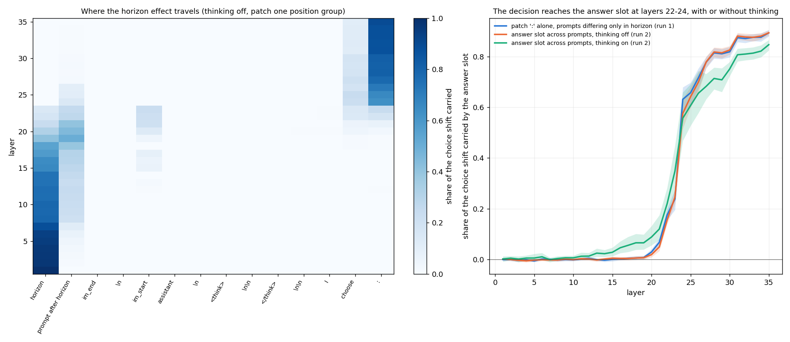
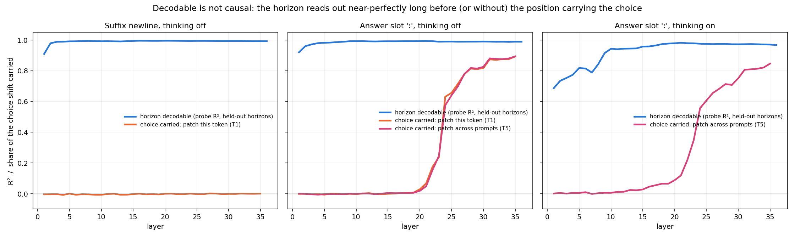
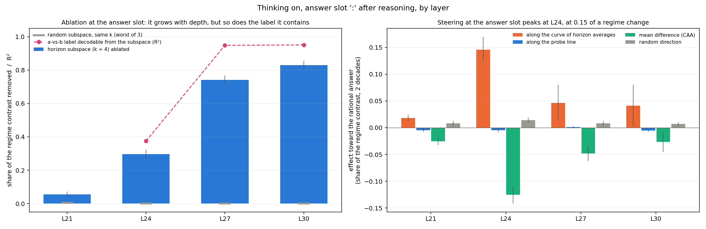

# Evidence index: each claim, its strength, and the plot behind it (2026-10-24, audited 2026-10-26: C1 struck, A1, B2, D1 corrected; see `01_plan.md` §6)

A review sheet. Every claim from `08`, `11` and `12` that we currently rely on, graded:
- **strong**: replicated on 8B and 14B, or pre-registered and passed;
- **supported**: one model, or a post-hoc test;
- **against**: a claim that failed or was weakened.

Each entry gives the figure, what to look at in it, and the document with the numbers. Figure
paths are relative to this file. `results/` lives outside the repo, so the
`../../results/...` links work on this machine only.

New figures for this index come from `analysis/evidence_figures.py` (saved results only).

## A. The pipeline: where the horizon goes

**A1. Four stages, in order, at matching relative depth on 8B and 14B. Strong.**
Horizon tokens → the prompt after the horizon → the answer slot `:` → the a/b label.
- In the figure, each row is a model and mode. The hand-off (orange) lands at 0.64–0.67 of
  depth in all four rows. 14B thinking on puts the hand-off and the binding in the same
  layer (L27); thinking off binds one layer after the hand-off, as 8B does (L27, corrected
  2026-10-26 from L30: 53 rows had scored the wrong label tokens, `11` §1).
- `encode_end` and `spread_peak` come from T1, whose "horizon" group left out a shared unit
  word in a third of the pairs; they may shift on a rerun. The hand-off and bind markers do
  not depend on T1's grouping.
- Numbers: `11` §1. S1 and S5 passed as pre-registered.

**A2. Only two template positions carry the choice: `choose` and `:`. Strong on 8B; 14B in
numbers only.**
- Left panel: where the horizon effect travels when one position group is patched
  (8B, thinking off). Early layers sit on the horizon tokens. By L22–24 the effect is on
  `choose` and `:`. Every other token stays near 0.
- Right panel: the answer slot picks up the choice at L22–24, with and without thinking.
- 14B: the same result in `11` §1 (every token except `choose` and `:` ≤ 0.11). There is no
  14B heatmap; the 14B data is in `exp8_Qwen3-14B_patch/`.

**A3. Decodable is not causal. Strong on 8B.**
- Blue is the probe R²; red and orange show how much of the choice that position carries.
- At the suffix newline the horizon decodes at about 0.99 at every layer and carries 0.
- At the answer slot it decodes from L1 but carries the choice only from L22–24.
- Numbers: `08` §1, §5.

## B. Is the answer-slot code the horizon or a decision?

**B1. 8B thinking on: steering along the curve moves the choice; the probe line does not.
Supported (8B).**
- Right panel: orange (curve) peaks at L24 at 0.15. Blue (probe line) is about 0 at every
  layer. Green (mean difference) steers backwards.
- Left panel: ablation grows with depth, but the a/b label becomes decodable from the same
  subspace (pink). From L27 on, ablating it removes the label by construction.
- The figure shows L21/24/27/30, all fit on all prompts. L22 is left out because its run
  refit the directions on natural closes only; its numbers are in `08` §12. The a/b line
  at L24 is 0.38 after refitting the PCs per fold (was 0.23, `08` §6).
- Numbers: `08` §7, §9.

**B1b. 14B: the probe line does not steer either; S4 passes as pre-registered. Strong
(8B and 14B).**
- The S4 test (`10` §S4), run 2026-10-24 (`exp8_Qwen3-14B_line_{off,on}`): the line moves
  the choice by ≤ 0.05 at every §4 cell, and at the hand-off cell the curve beats the line.
- Probe line, at |α| = 2: 0.022 at off L27 and ≤ 0.011 at the other five cells. The largest
  is still under half the S4 bound.
- Curve minus line: +0.10 [0.09, 0.11] at off L27, the 14B hand-off cell.
  - Thinking on L27: +0.02 [0.01, 0.03]. The CI excludes 0, but the curve itself is small
    there.
  - At L30/L33, thinking off, the curve moves 0.02 and nothing beats anything.
- The mean difference steers backwards at every cell where it moves at all: −0.05 to −0.09.
  That is the same median-split artifact as on 8B (`11` §3).
- Bars show the 95% bootstrap CI over prompts, with both signs pooled.

**B2. 14B answer slot: steering is mostly the decision direction; thinking on, ablating the
horizon subspace moves the choice but steering along it does not. Supported (14B, one run per
cell); the "beyond the decision" ablation readings are struck (audit 2026-10-26).**
- The decision direction is fitted in 8 dims but ablation is judged on the top k, where only
  part of it lies (0.23 at off L27, 0.53–0.64 elsewhere, 0.25 at 8B L24). So "ablation
  without the decision" and "decision alone" are not a split of the ablated subspace, and the
  numbers below in those columns do not say how much is horizon beyond the decision. The
  pre-registered verdicts stand. The steering split (k = 8) is exact.
- 14B off L27: steering the curve (0.15) is two thirds its decision part (0.10).
- 14B on L27: ablating the top-4 subspace removes 0.45 of the contrast, but steering along
  the curve without the decision moves 0.01.
- Off L30/L33 (ablation at k = 2): nothing moves. There the label sits in components 3–4
  (ablating k = 4 removes 0.61–0.72; not shown).
- **On L30/L33 (new, 2026-10-24): ablation removes 0.81 and 0.88 (0.79 and 0.88 "without the
  decision direction", which per the caveat above is not a clean split). This is the label, by
  construction, not evidence of horizon use.**
  - The a/b label is decodable from the same 4 components at R² 0.95 at both layers, and
    already 0.93 at L27. 8B gives 0.95 from L27.
  - Steering is small but nonzero, and none of it is through the decision direction. The
    curve without the decision moves 0.04 [0.01, 0.07] at L30 and 0.06 [0.02, 0.09] at L33.
  - L33 passes the pre-registered "horizon beyond decision" test (≥ 0.05, CI above 0, ≥ a
    third of the curve), but only barely. L30 fails it on size.
  - Judgment call: I read L33 as a weak effect and would not rest a claim on one cell just
    over the threshold.
  - The decision direction itself barely steers after the binding (0.02 / 0.01, against 0.13
    at L27).
  - Numbers: `exp8_Qwen3-14B_on_L30_L33/results.json`. The a/b check is in
    `analysis/steering_decision_check_14b.json`, using the same method as `08` §9.
- **Prefix-cache check passed end to end.** `on_L27_check` reran the thinking-on L27 cell
  with the new shared-prefix scoring and reproduced the full-pass run, to within 0.002 on
  every verdict number. Removed: 0.449 vs 0.448; without decision: 0.326 vs 0.328; curve:
  0.043 vs 0.043.
- Last panel: 8B on L24 for reference.
- Numbers: `11` §3, plus the files above for the L30/L33 thinking-on cells.

## C. Is it the same representation in both models?

**C1. Struck 2026-10-26 (was "the suffix code is shared across models, Strong").** Against a
null that keeps the same prompts grouped in both models, the suffix match is not significant.
- The heatmap's structure stands: near equal relative depth, CKA is 0.84–0.92 up to 8B L20,
  and every late 8B layer matches 14B L20–22 best.
- But the models see identical prompts, and any grouping of those prompts gives CKA about
  0.86 (shuffle p95 0.91, observed 0.88; within unit 0.77 vs p95 0.78). The old null of 0.2
  permuted rows, so it only compared different prompts.
- The cross-model readout (0.94) is below a unit-word lookup on the same averages (0.957).
- Numbers: `11` §2.

**C2. The answer-slot code: depths correspond at the hand-off; S2/S3 fail as pre-registered.**
- CKA is 0.1–0.4 and flat before the hand-off.
- At the hand-off the depths correspond: CKA 0.45 thinking off, 0.75 on, both above the
  label-shuffle null (p = 0.001; p95 0.30 / 0.56).
- Within unit it is not above that null (0.17 vs p95 0.24 off; 0.44 vs 0.52 on, shared
  natural closes).
- Thinking on: `cka_heatmap_pre-label_on.png`. Numbers: `11` §2.

## D. Is it magnitude, or the unit word? (Check 1)

**D1. On the horizon averages, 8B orders horizons within a unit from the first component;
per prompt, the low-k code is mostly the unit word. Supported; your decision is needed on
which level counts.**
- Orange is per prompt, blue is on horizon averages. Dashed 0.5 is the suffix criterion,
  dotted 0.3 the staircase criterion.
- The floor for "unit word only" is not 0: a leave-one-horizon-out unit lookup scores about
  −0.25 within unit at both levels (audit 2026-10-26). So 0.00 means slightly more than the
  unit word, and only clearly positive values mean magnitude within a unit.
- 8B pre-label off: 0.00 per prompt, 0.75 on averages.
- On 14B the first components at pre-label off are at the unit level at both levels (−0.05,
  against a lookup's −0.25).
- The 8B suffix criterion (≥ 0.5 from k = 1) is met at 0.503, with a 95% bootstrap CI over
  horizons of 0.20–0.67, so borderline; the MLP's 0.75 is clear.
- Thinking-on pre-label has little within-unit magnitude at low k at either level.
- Numbers: `12` §1a, §1c.

**D2. The thinking-on 8B 2-component "arc" was partly the forced-close signal. Against
(weakens `06` §4).**
- Dashed is all prompts, solid is natural closes only.
- 8B pre-label k = 2 loses 0.13–0.17 R² on natural closes. Nothing changes at k ≥ 3,
  and 14B doesn't move.
- Numbers: `12` §1b.

## E. Does the model combine horizon and delay before the hand-off? (Check 2)

**E1. A horizon × delay signal appears at the suffix newline from L15/16, 7–10 layers before
the hand-off, and follows the rational regime, not the choice. Supported (post-hoc,
decodable only).**
- Red is the projected probe, scored within each horizon. Horizon and delay directions are
  removed, so only their interaction can score.
- It jumps above the null (dotted) at L15 in both models, before the hand-off (blue line).
- 14B thinking-on pre-label is high from L1, most likely read off the reasoning text.
- The pre-registered pooled version is `regime_comparison.png`: above its null from L1, so
  uninformative (`12` §2a).
- Numbers: `12` §2b.

**E2. The signal is graded, not a yes/no comparison, except 14B thinking-on pre-label.
Supported (exploratory control).**
- Top row: AUC against the threshold shift. A yes/no comparison at h = far would peak at
  s = 0.
  - Only 14B thinking-on pre-label (orange dashed, right) peaks there.
  - The others are flat or higher for s < 0, then fall for s > 0.
- Bottom row: regime AUC (thick) against choice AUC (thin) by layer. From L15, regime
  beats choice by 0.2–0.5, except 8B thinking-on pre-label (0.80 vs 0.77 at L22).
- Numbers: `12` §2b, §2c.

## G. Does steering the horizon change the thinking-on choice? (E14, 2026-11-01)

**G1. Where an up-step moves the stated horizon, the choice moves as the unsteered model would at that horizon.
Observed, correlational (8B, one run, post hoc; parser audited 79/80 by a blind reader).**
- The donor patch at L16 puts a target-regime horizon in 104 of 104 traces and moves near log-odds +9.9 [8.3, 11.7].
- Natural closes, near log-odds change against what the behaviour map predicts from the stated horizon alone:

  | case | observed | predicted | random, same prompts |
  |---|---|---|---|
  | none → near, landed (13 prompts) | +11.5 | +10.9 | +0.1 |
  | near → both, moved within its regime (12 prompts) | +4.3 | +4.3 | |
  | near → both, landed | +6.3 | +18.9 | |
  | near → none, moved | +1.1 | −2.1 | |

- The none → near landings are all unit swaps. At the pre-registered L16 alone they reach about half the prediction
  (+4.9 against +9.4).
- The steer is also present when the answer is scored, so the written horizon is not shown to cause the choice.
- Numbers: `22` §2.

**G2. Steering along the pristine curve at the phrase fails H1–H3 as pre-registered. The stated horizon moves
specifically but saturates. Against.**
- On the 104 donor prompts the steer moves near log-odds +1.4, against the donor's +9.9. H2: +1.80 [0.58, 2.98],
  against a bar of 2.88.
- The steer moves the stated horizon on 55 prompts (L14–18), always toward the target; random 0 of 384.
  - **Within the unit:** about one decade whatever the step size, often as a digit edit (6 → 66 months).
  - **Further:** only by swapping to a longer unit from horizons of 4 months or less. These swaps follow the
    up-direction: on none → near at L16, steer 11/32, invariant 14/32, opposite 1, random 0.
- Landing was rare: 16 of 128 at L16.
- Numbers: `22` §1, §4.

**G3. The pristine curve is a written-number direction by construction. Supported (property of the fit).**
- The unit word accounts for 88% of the variance of log duration in the fit's prompts. With the unit as a separate
  term, the curve is fitted from the variation within a unit, where duration is the written number.
- At L16 (cross-fitted), the steer explains R² 0.02 of a real horizon-text change at the unit token. With the fit's
  unit term added it explains 0.78.
- This describes the vector. It does not by itself explain the model's response: same-unit prompts barely moved, and
  the invariant part also swapped units.
- Numbers: `22` §3.

## F. Not covered by a figure

- **Behavior and coherence** (`11` §4):
  - order stability: 8B off 55%, 14B off 74%, 14B on 81% (n = 80);
  - label stability: 84%, 65% and 81% respectively.
  - 8B has no thinking-on coherence run yet.
- **14B T1 heatmap** (the A2 left panel for 14B): data in `exp8_Qwen3-14B_patch/`, not drawn.
- **Closed 2026-10-24:** S4 on 14B (B1b), 14B thinking-on L30/L33 (B2).
- **Open, no data yet:**
  - whether the E1 signal is causal;
  - whether the 14B decision direction is 8B's (`11` next steps, item 3).
- `11_results_14b.md` §3 has not yet been updated with the rows above.
